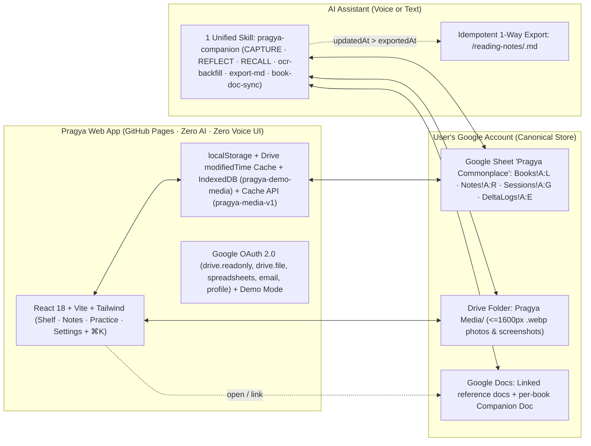

# Pragya — Authoritative Product & Technical Specification (v1.2)

> **One-liner:** A calm, zero-AI commonplace book, reading tracker, and behavioral delta PWA paired with the `pragya-companion` agent skill. Pick up your book with zero friction, capture quotes alongside *why* they mattered (plus photos and Google Docs), and—when an idea deserves rigor—spar to turn it into an atomic takeaway and a real-world Behavioral Delta.

---

## 1. Core Guardrails & Product Philosophy

1. **Zero AI & Zero Custom Voice UI in the Web App:** Pragya PWA executes zero LLM calls and contains zero custom mic/audio recording plumbing. Users can use native OS keyboard dictation in any `<textarea>`; conversational voice sparring lives in the `pragya-companion` AI assistant skill.
2. **Progressive Commonplace Card (`Phrase + Why I liked it` → `Atomic Note`):**
   - **Layer 1 (Quick Capture):** Verbatim quote (optional), personal takeaway (*Why I liked it* in the user's own words), `#tags`, optional `Spar w/ AI later` (`status = 'inbox'`) or `Fiction Prediction` flag, and up to **3 attachments** (WebP photo/screenshot, Google Doc chip, or URL chip).
   - **Layer 2 (Deepened Atomic Note):** Context & Mechanism, Behavioral Delta (`WHEN` trigger → `DO` action), Socratic Critique & Boundary Conditions, and `[[wikilink]]` concept connections with automatic in-memory Backlinks.
3. **Decouple Capture from Sparring:** Quick captures save immediately (`status = 'saved'`). Socratic sparring is strictly opt-in (`status = 'inbox'` or `'in-reflection'`).
4. **Genre-Aware Lens (`nonfiction` vs `fiction`):**
   - **Non-fiction** emphasizes Application, Logic Friction, and Behavioral Deltas.
   - **Fiction** emphasizes Craft/Resonance, Subtext, and **Sealed Predictions** strictly clamped to the user's current spoiler ceiling until the book is marked `finished`.
5. **Zero Stopwatches & Zero Overdue Flashcards:** Progress uses 1-tap bookmark advances (`+10p` / exact position, 30-min coalesced); retention uses a strict cap of **≤ 5 Active Behavioral Deltas** and a zero-guilt daily **Takeaway Shuffle**.
6. **Canonical Naming:** The brand, repo (`saimanoj01/pragya`), Drive folder (`Pragya Media/`), spreadsheet (`Pragya Commonplace`), browser caches (`pragya-media-v1`, `pragya-demo-media`), and skill (`pragya-companion`) use **Pragya** / `pragya` exclusively.

---

## 2. System Architecture



---

## 3. Tech Stack & Visual Design System (Nebula Monochrome)

Aligned with `/tmp/expense-ref`:
- **Stack:** React `^18.3.1`, TypeScript `^5.2+`, Vite `^5.2+`, Tailwind CSS `^3.4.4`, `lucide-react`, `framer-motion` (honoring `prefers-reduced-motion`), `sonner` toasts.
- **Typography:** `'Inter', ui-sans-serif, system-ui`, `font-feature-settings: 'cv11', 'ss01'`. Numeric indicators (pages, percentages, session counts, dates) MUST apply `.num` (`font-variant-numeric: tabular-nums; font-feature-settings: 'tnum', 'cv11', 'ss01'; letter-spacing: -0.01em;`).
- **Type Scale (`tailwind.config.js`):**
  - `display-xl`: `64px / 64px`, `-0.035em`, `600`
  - `display-l`: `40px / 44px`, `-0.025em`, `600`
  - `title`: `22px / 28px`, `-0.015em`, `600`
  - `heading`: `15px / 22px`, `-0.005em`, `600`
  - `body`: `14px / 20px`, `400`
  - `label`: `12px / 16px`, `500`
  - `eyebrow`: `11px / 16px`, `0.06em`, `600`
- **Card Radius:** `--radius: 14px` (`rounded-lg` / `rounded-[14px]`). Inner buttons/chips use `8px`–`10px`.
- **HSL Color Tokens (`src/index.css`):**

| Token | Dark (`:root, .dark`) | Light (`.light`) | Usage |
|---|---|---|---|
| `--background` | `228 12% 5%` (`#0B0C0F`) | `60 9% 98%` (`#FAFAF9`) | App canvas |
| `--card` | `228 10% 8%` (`#131418`) | `0 0% 100%` (`#FFFFFF`) | Primary cards & modals |
| `--surface-2` | `228 9% 11%` (`#1A1B20`) | `240 5% 96%` (`#F4F4F5`) | Hover, inset panels, pills |
| `--popover` | `228 10% 10%` | `0 0% 100%` | Popovers, autocomplete |
| `--border` | `228 8% 16%` | `240 6% 91%` | 1px hairlines |
| `--input` | `228 8% 18%` | `240 6% 88%` | Form field borders |
| `--foreground` | `220 14% 94%` (`#EDEEF1`) | `228 12% 6%` (`#0D0E11`) | Primary text |
| `--muted-foreground` | `222 7% 63%` (`#9DA0A8`) | `222 6% 38%` (`#5A5E66`) | Secondary text |
| `--faint` | `222 7% 55%` (`#848893`) | `222 6% 43%` (`#676B75`) | Tertiary captions / dots |
| `--primary` | `220 14% 94%` | `228 12% 8%` | Monochrome primary CTA fill |
| `--primary-foreground` | `228 12% 6%` | `0 0% 100%` | Monochrome primary CTA text |
| `--secondary` / `--muted` / `--accent` | `228 9% 13%` | `240 5% 95%` | Neutral interactive surfaces |
| `--destructive` / `--c-negative` | `357 85% 64%` | `357 72% 41%` | Destructive / error states |
| `--c-saved` (`positive`) | `152 62% 52%` | `156 84% 24%` | Applied / Graduated / Success |
| `--c-nonmonthly` (`warning`) | `38 92% 62%` | `36 90% 28%` | Missed Trigger / Sparring badge |
| `--c-fixed` | `221 83% 66%` | `221 70% 52%` | Optional semantic accent |
| `--c-variable` | `194 86% 56%` | `196 88% 35%` | Optional semantic accent |

### Responsive Application Shell
- **Desktop (`md:` `>= 768px`):**
  - Left collapsible `Sidebar`: **`244px`** expanded, **`64px`** collapsed (persisted in `localStorage('pragya_sidebar_collapsed')`).
  - Top brand cluster: Lotus mark (`🪷`) + **`Pragya`** + mode badge (`Demo` or `Cloud`) + collapse toggle (`<` / `>`).
  - Primary CTA: `+ Capture (N)` button (`w-full`, high-contrast `bg-primary text-primary-foreground`).
  - Search trigger: `Search…` + `⌘K` badge.
  - Primary nav items: `Shelf` (`#/shelf`), `Notes` (`#/notes`), `Practice` (`#/practice`), `Settings` (`#/settings`).
  - Bottom footer: User avatar/email or Demo indicator, Dark/Light theme toggle, Logout button.
- **Mobile (`< 768px`):**
  - Fixed 5-slot `BottomNav`:
    1. `Shelf` (`#/shelf`)
    2. `Notes` (`#/notes`)
    3. Center elevated circular `+` Capture button (`w-11 h-11 rounded-full -mt-4 bg-primary text-primary-foreground`)
    4. `Practice` (`#/practice`)
    5. `More` (opens slide-up drawer `data-popover="true"` with `Settings`, `Sync Now (R)`, `Theme Toggle`, and `Account / Logout`).
  - Header action buttons (e.g., `Add Book`) MUST include `whitespace-nowrap shrink-0` so labels never wrap awkwardly across lines on `390px` viewports.

---

## 4. Locked Google Sheet Schema & TypeScript Data Contracts

Spreadsheet Title: **`Pragya Commonplace`** (auto-discovered by exact name or created on first Google login; optional override via `localStorage('pragya_spreadsheet_id')`).

### Tab 1: `Books!A:L` (12 Columns)
| Col | Header | TS Type | Notes |
|---|---|---|---|
| `A` | `id` | `string` (UUID v4) | Immutable primary key |
| `B` | `title` | `string` | Book title |
| `C` | `author` | `string` | Author(s) |
| `D` | `format` | `'physical' \| 'kindle'` | Reading medium |
| `E` | `kind` | `'nonfiction' \| 'fiction'` | Drives Socratic lens & Sealed Predictions |
| `F` | `status` | `'reading' \| 'queued' \| 'finished' \| 'paused'` | Shelf bucket |
| `G` | `currentPos` | `number` | Monotonic (`Math.max`) unless manual override |
| `H` | `totalPos` | `number` | Total pages/locs, `100` for `%`, `0` if unknown |
| `I` | `posUnit` | `'page' \| 'percent' \| 'loc'` | Display unit |
| `J` | `normalizedPos` | `number` (`0.0–1.0`) | Cross-unit spoiler comparator |
| `K` | `docUrl` | `string` | Optional Book Companion Google Doc URL |
| `L` | `metaJson` | `string` (JSON) | `BookMetaJson` |

### Tab 2: `Notes!A:R` (18 Columns)
| Col | Header | TS Type | Notes |
|---|---|---|---|
| `A` | `id` | `string` (UUID v4) | Immutable primary key |
| `B` | `slug` | `string` | Unique `<concept-slug>` for `[[wikilinks]]` & `.md` export |
| `C` | `bookId` | `string` | FK → `Books.id` |
| `D` | `createdAt` | `string` (ISO-8601) | Creation timestamp |
| `E` | `updatedAt` | `string` (ISO-8601) | Last mutation timestamp |
| `F` | `pos` | `number \| string` | Position in book's unit |
| `G` | `normalizedPos` | `number` (`0.0–1.0`) | Spoiler-ceiling comparator |
| `H` | `status` | `'saved' \| 'inbox' \| 'in-reflection' \| 'atomic'` | Lifecycle stage |
| `I` | `source` | `'app' \| 'agent'` | Origin audit trail |
| `J` | `tags` | `string` (CSV) | Normalized comma-separated tags (e.g. `#systems, #feedback-loops`) |
| `K` | `quote` | `string` | Verbatim quote (or OCR-backfilled passage) |
| `L` | `takeaway` | `string` | **Why I liked it / Core Takeaway (strictly user's own words)** |
| `M` | `contextMechanism` | `string` | Layer 2: Author's mechanism / scene & craft |
| `N` | `critique` | `string` | Layer 2: Socratic critique & boundary conditions |
| `O` | `deltaTrigger` | `string` | Layer 2: Trigger condition (stored/rendered without duplicate `WHEN`) |
| `P` | `deltaAction` | `string` | Layer 2: Concrete action (stored/rendered without duplicate `DO`) |
| `Q` | `deltaStatus` | `'none' \| 'active' \| 'graduated' \| 'paused'` | Drives `#/practice` (`active` capped at `<= 5`) |
| `R` | `metaJson` | `string` (JSON) | `NoteMetaJson` |

### Tab 3: `Sessions!A:G` (7 Columns — 30-Min Coalesced)
| Col | Header | TS Type | Notes |
|---|---|---|---|
| `A` | `id` | `string` (UUID v4) | Immutable primary key |
| `B` | `bookId` | `string` | FK → `Books.id` |
| `C` | `date` | `string` (`YYYY-MM-DD`) | Local calendar date |
| `D` | `startPos` | `number` | Position when session started |
| `E` | `endPos` | `number` | Latest position reached in session |
| `F` | `updatedAt` | `string` (ISO-8601) | Drives 30-minute coalescing window |
| `G` | `note` | `string` | Optional short session note |

### Tab 4: `DeltaLogs!A:E` (5 Columns)
| Col | Header | TS Type | Notes |
|---|---|---|---|
| `A` | `id` | `string` (UUID v4) | Immutable primary key |
| `B` | `noteId` | `string` | FK → `Notes.id` |
| `C` | `date` | `string` (`YYYY-MM-DD`) | Local calendar date of check-in |
| `D` | `outcome` | `'applied' \| 'missed' \| 'no-trigger'` | `1` / `2` / `3` practice outcome |
| `E` | `reflection` | `string` | Optional reflection or edited trigger note |

### Canonical TypeScript Types (`src/types/pragya.ts`)

```ts
export type BookFormat = 'physical' | 'kindle';
export type BookKind = 'nonfiction' | 'fiction';
export type BookStatus = 'reading' | 'queued' | 'finished' | 'paused';
export type PosUnit = 'page' | 'percent' | 'loc';

export interface BookMetaJson {
  coverUrl?: string;
  startedAt?: string;
  finishedAt?: string;
  updatedAt: string;
}

export interface Book {
  id: string;
  title: string;
  author: string;
  format: BookFormat;
  kind: BookKind;
  status: BookStatus;
  currentPos: number;
  totalPos: number;
  posUnit: PosUnit;
  normalizedPos: number;
  docUrl: string;
  meta: BookMetaJson;
}

export type NoteStatus = 'saved' | 'inbox' | 'in-reflection' | 'atomic';
export type NoteSource = 'app' | 'agent';
export type DeltaStatus = 'none' | 'active' | 'graduated' | 'paused';

export type Attachment =
  | {
      id: string;
      type: 'image';
      driveFileId?: string;
      demoMediaId?: string;
      fileName: string;
      mimeType: string;
      width?: number;
      height?: number;
    }
  | {
      id: string;
      type: 'doc';
      title: string;
      url: string;
      docId?: string;
    }
  | {
      id: string;
      type: 'link';
      title: string;
      url: string;
    };

export interface NoteMetaJson {
  title?: string;
  attachments: Attachment[]; // max 3 per note
  links: string[];           // optional standalone URLs for back-compat / CLI
  isPrediction?: boolean;
  socraticQuestions?: [string, string];
  ocrBackfilled?: boolean;
  exportedAt?: string;
  lastReviewedAt?: string;
}

export interface Note {
  id: string;
  slug: string;
  bookId: string;
  createdAt: string;
  updatedAt: string;
  pos: number;
  normalizedPos: number;
  status: NoteStatus;
  source: NoteSource;
  tags: string[]; // serialized as CSV in column J
  quote: string;
  takeaway: string;
  contextMechanism: string;
  critique: string;
  deltaTrigger: string;
  deltaAction: string;
  deltaStatus: DeltaStatus;
  meta: NoteMetaJson;
}

export interface ReadingSession {
  id: string;
  bookId: string;
  date: string; // YYYY-MM-DD
  startPos: number;
  endPos: number;
  updatedAt: string;
  note: string;
}

export type DeltaOutcome = 'applied' | 'missed' | 'no-trigger';

export interface DeltaLog {
  id: string;
  noteId: string;
  date: string; // YYYY-MM-DD
  outcome: DeltaOutcome;
  reflection: string;
}

export interface PragyaSnapshot {
  version: 1;
  exportedAt: string;
  books: Book[];
  notes: Note[];
  sessions: ReadingSession[];
  deltaLogs: DeltaLog[];
}
```

### Schema Auto-Repair Rules
On initial Sheets connection (and after creating a new spreadsheet):
1. Query spreadsheet metadata (`GET /v4/spreadsheets/{id}?fields=sheets.properties`).
2. Ensure tabs `Books`, `Notes`, `Sessions`, `DeltaLogs` all exist (`batchUpdate` `addSheet` for any missing tab; remove default `Sheet1` only if empty and other tabs exist, or rename `Sheet1` to `Books`).
3. Inspect row 1 of each tab (`A1:L1`, `A1:R1`, `A1:G1`, `A1:E1`); if empty or mismatched, write the exact canonical header row without overwriting rows `>= 2`.

---

## 5. Production Safeguards (Locked Contracts)

1. **UUID-Resolved Sheet Writes (Zero Row-Index Drift):**
   - Never cache row indices for writes.
   - Both `GoogleSheetsAdapter` and `pragya-companion` MUST fetch `<Tab>!A:A` at write time, resolve the exact 1-based row index matching `row.id`, and issue `PUT .../values/<Tab>!A{row}:{lastCol}{row}?valueInputOption=RAW`.
   - If the UUID is absent in `A:A`, append via `POST .../values/<Tab>!A1:append?valueInputOption=RAW&insertDataOption=INSERT_ROWS`.
2. **Monotonic Bookmark Ceiling (`Math.max` + Explicit Override):**
   - Standard progress updates (`+10p`, quick position input, `QuickCaptureModal` save, `pragya-companion capture`) enforce:
     `nextPos = Math.max(book.currentPos, incomingPos)`
     `nextNorm = Math.max(book.normalizedPos, computeNormalizedPos(nextPos, book.totalPos, book.posUnit))`
   - If `book.totalPos > 0`, cap `nextPos` to `book.totalPos` only when explicitly advancing beyond total OR update `normalizedPos = clamp01(nextPos / book.totalPos)`.
   - Lowering a bookmark below `book.currentPos` is rejected unless the user explicitly checks **"Manual Bookmark Reset / Override"** (`manual-pos-override-checkbox`) in `BookDetailView` (or passes `--force-pos` in CLI).
3. **30-Minute Session Coalescing:**
   - On any reading progress update for `(bookId, incomingPos)`:
     - Compute `today = YYYY-MM-DD` (local time).
     - Find existing `Sessions` row where `s.bookId === bookId && s.date === today && (nowMs - Date.parse(s.updatedAt)) <= 30 * 60 * 1000`.
     - If found: update that session's `endPos` (using `Math.max(s.endPos, nextPos)` unless manual override) and `updatedAt = nowIso` via UUID-resolved write.
     - Else: append a new `Sessions` row with `startPos = prevPos`, `endPos = nextPos`, `updatedAt = nowIso`.
4. **Drive `modifiedTime` Fast-Reload Cache:**
   - Store hydrated workspace state + `spreadsheetId` + `modifiedTime` in `localStorage('pragya_sheets_cache_v1')`.
   - On app load (when not clicking manual `Sync Now (R)`), first call `GET https://www.googleapis.com/drive/v3/files/{spreadsheetId}?fields=modifiedTime`.
   - If `remote.modifiedTime === cached.modifiedTime`, hydrate from `pragya_sheets_cache_v1` in `0ms` and skip fetching `Books!A:L`, `Notes!A:R`, `Sessions!A:G`, `DeltaLogs!A:E`.
   - After any local Sheet mutation, update `pragya_sheets_cache_v1` optimistically and refresh `modifiedTime`.
5. **Normalized Spoiler Math (`0.0–1.0`):**
   - `computeNormalizedPos(pos, totalPos, posUnit)`:
     - If `posUnit === 'percent'`: `clamp01(pos / 100)`
     - Else if `totalPos > 0`: `clamp01(pos / totalPos)`
     - Else: `0`
   - `isNoteSpoiler(note, book)`:
     - If `!book || book.status === 'finished'` → `false`
     - If `book.totalPos > 0 || book.posUnit === 'percent'` → `note.normalizedPos > book.normalizedPos`
     - Fallback (when `totalPos === 0` and not percent) → `Number(note.pos) > book.currentPos`
   - **Sealed Fiction Predictions:**
     - If `note.meta.isPrediction && book.kind === 'fiction' && book.status !== 'finished'`, the note shows a **`SEALED PREDICTION`** badge (and remains visible if `note.pos <= book.currentPos`, or spoiler-blurred if `isNoteSpoiler(note, book)` is true).
     - Once `book.status === 'finished'`, all notes & predictions unlock (`UNLOCKED PREDICTION`), appear in `PracticeView` → **Unlocked Fiction Predictions**, and are no longer blurred.
6. **Private Drive Images (`<DriveImage />`) & Cross-Client Safety:**
   - **Client-side compression:** Before storing/uploading any pasted or picked image, resize proportionally in an offscreen `<canvas>` so `Math.max(width, height) <= 1600`, encode as `image/webp` (`quality = 0.82`), fallback to `image/jpeg` if browser canvas returns non-WebP.
   - **Google Mode Upload:** Multipart `POST https://www.googleapis.com/upload/drive/v3/files?uploadType=multipart` into Drive folder `Pragya Media/` (`mimeType: 'image/webp'`). Store `{ id, type: 'image', driveFileId, fileName, mimeType, width, height }`. Never set public permissions; never store expiring `thumbnailLink` URLs.
   - **Google Mode Fetch (`<DriveImage />`):** Look up Cache API (`caches.open('pragya-media-v1')`) using synthetic request URL `https://pragya.local/drive-media/${driveFileId}`. On miss, fetch `GET https://www.googleapis.com/drive/v3/files/${driveFileId}?alt=media` with `Authorization: Bearer <token>`, clone into `pragya-media-v1` if `res.ok`, return `URL.createObjectURL(blob)` (revoked on unmount).
   - **Append-Only Blobs:** Removing an image from a note only removes the entry from `Notes.metaJson.attachments`; never call `DELETE /drive/v3/files/{id}` from the PWA (avoids `403` cross-client `drive.file` ownership conflicts with `pragya-companion`).
   - **Demo Mode Media:** Store compressed `Blob` in `IndexedDB` (`db: 'pragya-demo-media'`, `store: 'blobs'`, key `demoMediaId`). Never store raw base64 image payloads in `localStorage`.

---

## 6. Browser Google OAuth 2.0 Flow & Session Lifecycle

Modeled strictly after `/tmp/expense-ref/src/context/AuthContext.tsx`:

1. **Client ID Resolution Order:**
   1. `import.meta.env.VITE_GOOGLE_CLIENT_ID`
   2. `window.VITE_GOOGLE_CLIENT_ID`
   3. `localStorage.getItem('pragya_google_client_id')`
   (Settings & LoginView allow pasting/saving a custom Client ID into `pragya_google_client_id`.)
2. **OAuth Scopes:**
   - `https://www.googleapis.com/auth/drive.readonly` (read Doc titles, spreadsheet `modifiedTime`)
   - `https://www.googleapis.com/auth/drive.file` (create/edit Pragya Sheet + `Pragya Media/` images)
   - `https://www.googleapis.com/auth/spreadsheets` (read/write 4 tabs)
   - `email`
   - `profile`
3. **CSRF & Implicit Flow:**
   - Generate `csrfState = crypto.randomUUID()`, persist in `sessionStorage.setItem('pragya_oauth_csrf_state', csrfState)`.
   - Redirect URI: `window.location.origin + window.location.pathname`.
   - Test hook: When `window.__PLAYWRIGHT__ === true || navigator.userAgent.includes('Playwright') || window.VITE_GOOGLE_CLIENT_ID !== undefined`, `login()` awaits SPA `hashchange` instead of navigating away to `accounts.google.com`.
4. **SPA Hash Token Extraction BEFORE Hash Router:**
   - `AuthContext` runs first on mount and `hashchange`:
     - If `window.location.hash.includes('access_token=')`, parse `access_token` and `state`, verify `state === sessionStorage.getItem('pragya_oauth_csrf_state')`, fetch `https://www.googleapis.com/oauth2/v3/userinfo` (graceful fallback `{ email: 'cloud@example.com', name: 'Google User' }`), save `pragya_google_token` + `pragya_google_user`, set `pragya_mock_mode = 'false'`, and reset hash to `#/shelf`.
     - If `hash.includes('error=access_denied')`, surface `"Access Denied"` toast and clear hash.
   - `navigation.ts` `parseHash()` MUST treat `access_token=` / `error=` hashes as non-navigation OAuth callbacks (never breaking on unparseable route segments).
5. **Token Validation & 401 Expiry Modal:**
   - `isInvalidOrExpiredToken(token)` checks empty string, `'EXPIRED_TOKEN'`, or expired JWT `exp <= Date.now()` while allowing opaque `ya29...` tokens.
   - Any `401 Unauthorized` response from Sheets/Drive APIs clears `pragya_google_token` and opens `session-expired-modal` with **"Reconnect Google"** and **"Continue in Demo Mode"** actions without discarding the user's current route.
6. **Demo Mode (`loginAsMock()`):**
   - Works completely offline with zero Client ID required.
   - Seeds deterministic, rich initial data (`Thinking in Systems: A Primer`, `Exhalation: Stories`, `The Lathe of Heaven`, `Finite and Infinite Games`, plus 8 realistic commonplace/atomic/prediction/spoiler notes, 11 reading sessions across recent days, and delta logs) stored in `localStorage('pragya_demo_state_v1')`.

---

## 7. Screens, Routes, Interactions & Defect Fixes

| Route | Component | Core Requirements |
|---|---|---|
| *(unauth)* | `LoginView` | Pragya brand + tagline, **Sign in with Google** (or disabled/guided if Client ID missing + expandable custom Client ID input), **Continue in Demo Mode**, light/dark toggle. |
| `#/shelf` | `ShelfView` | Header (`Shelf`, subtitle, `Add Book` button `whitespace-nowrap`), **30-Day Reading Activity Dots** (see responsive rule below), **Now Reading** hero cards (1–2 active books) showing format/kind badges, edit icon, `p. X / Y` + `%` + progress bar, **Re-Entry Context** (last read date + latest note/prediction quote or takeaway), 1-tap `+10p` + exact position input/arrow button, `Book Doc ↗` link (if `docUrl` set), `+ Capture` button. Below: `Queued` (`Start Reading →`), `Finished` (`100% Completed`), `Paused` sections. |
| `#/book/:id` | `BookDetailView` | Back to Shelf link, book header card with format/kind/status badges, edit book icon, progress bar (`p. X / Y` + `%`), `+10p` + exact input + `Advance`, **`Manual Bookmark Reset / Override`** checkbox (required to allow lowering `currentPos`), `Mark as Finished` button (sets `status = 'finished'`, `normalizedPos = 1`, `finishedAt = now`, unlocks predictions), `+ Capture` / `+ New Note from this Book`. Below: all book notes ordered by position with **Spoiler Shield** for notes above `book.normalizedPos` (click or press `Space` to reveal locally). |
| `#/notes` | `NotesView` | Header + `+ Quick Capture`, instant search input (searches `quote`, `takeaway`, `title`, `slug`, `tags`, book `title`/`author`), filter pills: `All` · `To Spar` (`inbox` / `in-reflection`) · `Atomic` · `Has Media` · `[[Concepts]]` (filters notes having `[[wikilinks]]` or clicking a concept pill). Each card shows book title, pos, status badge (`INBOX`, `IN REFLECTION`, `ATOMIC`, `SEALED PREDICTION`), inline **Spoiler Shield** overlay when `isNoteSpoiler(note, book)` is true (with `Reveal Quote (or Space)` button), tags, attachment count/chips, and `VIEW NOTE ↗`. |
| `#/note/:slug` | `NoteDetailView` | Back to Notes link, book/pos/status header + `Edit Note (E)` + `Deepen Note (D)` buttons, **Socratic Recovery Banner** (rendered when `status === 'in-reflection'` and `meta.socraticQuestions` has 1–2 saved questions, displaying them directly above a `Continue Deepening →` action), Verbatim Quote blockquote, Core Takeaway / Why I Liked It, clickable `[[wikilinks]]` chips (navigating to `#/note/:targetSlug`, or prompting to create if target doesn't exist), Layer 2 sections (`Context & Mechanism`, `Behavioral Delta` with clean single `WHEN`/`DO` prefixes, `Socratic Critique & Boundary Conditions`), Attachments grid (`<DriveImage />` thumbnails opening **Image Lightbox**, Google Doc chips, Link chips), and **Referenced By (Backlinks)** computed in-memory excluding self-links (`n.slug !== current.slug`). |
| `#/practice` | `PracticeView` | Header + `Export JSON` + `Import JSON` buttons. **Active Behavioral Deltas (`N/5`)**: displays active deltas (`deltaStatus === 'active'`) with clean single `WHEN` / `DO` lines, check-in summary, `View Note →`, action buttons `Applied (1)`, `Missed Trigger (2)` (opens inline trigger editor so user can refine `deltaTrigger` immediately after a miss!), `Didn't Come Up (3)`, `Graduate`, `Pause`. **Paused & Graduated Deltas**: compact cards with `Reactivate` (enforcing `<= 5` active cap). **Takeaway Shuffle**: deterministic daily rotation (`YYYY-MM-DD`) of up to 3 cards (`>= 14 days` old or tagged `#favorite`/`#favorites`, excluding spoilers, sealed predictions, and notes with `lastReviewedAt === today`), with `Mark Reviewed` button. **Unlocked Fiction Predictions**: shown when any fiction prediction belongs to a `finished` book. |
| `#/settings` | `SettingsView` | Mode summary (`Demo Mode` vs `Google Account`), Google Client ID override (`pragya_google_client_id`), Connected Spreadsheet ID / Link (`Pragya Commonplace`), Drive Media folder (`Pragya Media/`) status, `Sync Now (R)` button, Theme switcher, JSON Snapshot Export/Import shortcut, `Reset Demo Data` (Demo mode), and Logout. |

### Mandatory UI Defect Fixes (From Visual Review)
1. **No Duplicate `WHEN WHEN` / `DO DO` Prefix:**
   - Implement `normalizeDeltaText(value, prefix: 'WHEN' | 'DO')`: strips repeating case-insensitive leading `WHEN ` / `WHEN: ` or `DO ` / `DO: ` tokens (e.g., `/^(?:(?:when|do)\s*:?\s*)+/i` scoped per field: `/^(?:when\s*:?\s*)+/i` for trigger, `/^(?:do\s*:?\s*)+/i` for action).
   - Store normalized body text without the prefix AND apply the strip helper at render time (`PracticeView`, `NoteDetailView`) before rendering the single bold `WHEN` / `DO` label prefix.
2. **No Mobile Horizontal Overflow on 30-Day Activity Dots (`390×844`):**
   - In `ShelfView`, the 30-day activity dots container MUST render all 30 days cleanly inside the card width with zero horizontal clipping or `scrollWidth > clientWidth` on `390px` viewports:
     - Mobile (`< 640px`): CSS grid `grid-cols-15 gap-1.5` (2 clean rows of 15 square/circular `w-2.5 h-2.5` or `aspect-square` dots filling container width) OR responsive `grid-cols-15 sm:grid-cols-30`.
     - Desktop (`>= 640px`): single horizontal row of 30 dots (`sm:flex sm:items-center sm:gap-1.5`).

### Modals & Overlays
- **`QuickCaptureModal` (`N`):** Book selector, Position input (auto-prefilled from selected book's `currentPos`, unit label matched to `book.posUnit`), Verbatim Quote textarea (optional), Why I Liked It / Core Takeaway textarea (required unless quote or attachment provided; encourage user's own words), `#tags` CSV input, `Spar w/ AI later` checkbox (`status = 'inbox'`), `Fiction Prediction` checkbox (shown/enabled when selected book is `fiction` → sets `meta.isPrediction = true`), Attachments bar (`Photo`, `Doc`, `Link` — disabled at `3/3` with clear count `Attachments (N/3)`). Supports global `⌘V` / `Ctrl+V` paste inside modal for images (WebP `<=1600px` compression) and URLs (auto-detecting `docs.google.com/document/d/<id>` as Doc chips and resolving doc title via `drive.readonly` when online).
- **`AddBookModal` / `EditBookModal`:** Title, Author, Format (`physical` / `kindle`), Kind (`nonfiction` / `fiction`), Status (`reading` / `queued` / `finished` / `paused`), Current Position, Total Position, Unit (`page` / `percent` / `loc`), Companion Google Doc URL.
- **`DeepenNoteModal` (`D`):** Displays persisted `socraticQuestions` banner if `status === 'in-reflection'`, editable Title/Slug, Core Takeaway, Context & Mechanism, Behavioral Delta (`deltaTrigger`, `deltaAction`, `deltaStatus` — enforcing `<= 5` active cap with inline notice if already at 5/5 active on another note), Socratic Critique, and **Inline `[[wikilink]]` Autocomplete** popover (`data-popover="true"`) triggered when typing `[[` in Takeaway / Context / Critique fields. Saving upgrades status to `'atomic'` (when Layer 2 fields or takeaway deepened) unless explicitly saved as draft.
- **`EditNoteModal` (`E`):** Edit any Layer 1/Layer 2 field, `[[wikilink]]` autocomplete, manage attachments (remove reference safely without deleting Drive file, or add up to 3), toggle `isPrediction`.
- **`CommandPalette` (`⌘K` / `Ctrl+K`):** Instant fuzzy search across books, notes (`quote`, `takeaway`, `title`, `tags`, `slug`), and quick actions (`New Capture`, `Go to Shelf`, `Go to Notes`, `Go to Practice`, `Toggle Theme`, `Sync Now`).
- **`ImageLightbox`:** Full-screen viewer over `<DriveImage />` triggered by clicking an image attachment or pressing `Space` on `NoteDetailView`; closes on backdrop click or `Escape`.
- **`ImportConfirmModal`:** Validates uploaded JSON against `PragyaSnapshot` schema (`version === 1`, arrays `books`, `notes`, `sessions`, `deltaLogs`, valid enums/UUIDs) and shows item counts before replacing workspace state.

### Keyboard Map & Input Focus Guard
Single-key / chord shortcuts MUST NOT fire when `document.activeElement` is `<input>`, `<textarea>`, `<select>`, or `[contenteditable="true"]` (except `⌘K`/`Ctrl+K` and `Escape`):
- `⌘K` / `Ctrl+K`: Toggle `CommandPalette`
- `N`: Open `QuickCaptureModal`
- `G` then `S` / `N` / `P` (within `1000ms`): Navigate to `#/shelf`, `#/notes`, `#/practice`
- `J` / `K` + `Enter`: Move focus index in card lists (`NotesView`, `BookDetailView`, `PracticeView`) and open on `Enter`
- `Space`: Reveal Spoiler Shield on active card (`NotesView` / `BookDetailView`) or toggle Image Lightbox (`NoteDetailView`)
- `O`: Open primary Google Doc or first external link on active book/note
- `D`: Open `DeepenNoteModal` on `#/note/:slug` or selected note
- `E`: Open `EditNoteModal` on `#/note/:slug` or `EditBookModal` on `#/book/:id`
- `1` / `2` / `3`: Log `Applied` / `Missed Trigger` / `Didn't Come Up` on active delta in `PracticeView`
- `R`: Trigger `Sync Now`
- `Escape` (layered priority):
  1. Close `[data-popover="true"]` (`wikilink-autocomplete`, mobile `More` drawer) or `ImageLightbox` (`stopPropagation`)
  2. Close topmost open Modal or `CommandPalette`
  3. On detail routes (`#/book/:id` → `#/shelf`, `#/note/:slug` → `#/notes`), navigate back to parent list view.

---

## 8. Unified Agent Skill (`pragya-companion`)

Location: `.agents/skills/pragya-companion/SKILL.md` + Python CLI `scripts/pragya_cli.py` (Python 3 stdlib + subprocess adapters for `gsheets`, `gdrive`, `gdocs`, plus `--state-file <path.json>` offline/test backend).

### Supported Modes & CLI Subcommands

1. **`CAPTURE` (`pragya_cli.py capture`):**
   - Inputs: `--book <id|title>`, `--pos <num>`, `--quote <text>`, `--takeaway <text>`, `--tags <csv>`, `--spar` (`status='inbox'`), `--prediction`, `--image <path>`, `--doc-url <url>`, `--link <url>`, `--force-pos`.
   - Enforces `Math.max` bookmark ceiling (unless `--force-pos`), 30-min session coalescing, optional upload of local image to `Pragya Media/`, and UUID-resolved write to `Notes!A:R` (`source = 'agent'`).
2. **`REFLECT` (`pragya_cli.py reflect` — 4-Stage Socratic State Machine):**
   - **Stage 1 (`--stage 1`):** Persists note with `status = 'in-reflection'`, generates 2 genre-aware Socratic questions (`[Application, Critique]` for non-fiction; `[Resonance, Subtext/Prediction]` for fiction strictly clamped to `<= book.normalizedPos`), stores them in `metaJson.socraticQuestions`, and prints a blocking prompt for Stage 2.
   - **Stage 2 (Blocking Wait):** Assistant MUST stop and await user's reply before proceeding.
   - **Stage 3/4 (`--stage commit`):** Commits user's distilled phrasing into `takeaway`, `contextMechanism`, `critique`, `deltaTrigger`, `deltaAction`, `deltaStatus` (enforcing `<= 5` active delta cap; refuses `'active'` if 5 already active unless another is paused/graduated), and upgrades `status = 'atomic'` via UUID-resolved write.
3. **`RECALL` (`pragya_cli.py recall`):**
   - Modes: `--mode qa` (spoiler-safe cross-book context query clamping fiction books to `<= currentPos`), `--mode checkin` (logs `DeltaLogs` `applied|missed|no-trigger` for active deltas), `--mode shuffle` (returns deterministic daily Takeaway Shuffle candidates).
4. **`ocr-backfill` (`pragya_cli.py ocr-backfill`):**
   - Scans `Notes` where `metaJson.attachments` contains an image (`driveFileId` or `localPath`), `quote` is empty, and `!metaJson.ocrBackfilled`.
   - Downloads Drive image via `gdrive readonly download` (or reads local file in `--state-file` mode), applies OCR text (`--ocr-text` / `--ocr-map-json` / pluggable OCR command), writes `quote` and sets `metaJson.ocrBackfilled = true` via UUID-resolved update.
5. **`export-md` (`pragya_cli.py export-md`):**
   - Idempotent incremental 1-way Markdown export to `<output_dir>/<slug>.md` (default `./reading-notes/<slug>.md`).
   - Processes ONLY rows with `status === 'atomic'` where `!metaJson.exportedAt || updatedAt > metaJson.exportedAt`.
   - Generates clean Markdown with YAML frontmatter (`id`, `slug`, `book`, `author`, `pos`, `tags`, `updatedAt`), Quote, Core Takeaway, Context & Mechanism, Behavioral Delta (single `WHEN` / `DO` lines), Critique, Attachments, and `[[wikilinks]]`.
   - Atomically stamps `metaJson.exportedAt = nowIso` on the `Notes` row via UUID-resolved write **only after** the `.md` file is successfully written. Re-running with no newer `updatedAt` performs zero writes (idempotent no-op).
6. **`book-doc-sync` (`pragya_cli.py book-doc-sync`):**
   - Creates or updates a Book Companion Google Doc via `gdocs` (or records synced summary in `--state-file` mode), links `Books.docUrl` via UUID-resolved update, and appends distilled atomic notes for that book without creating duplicate replacement Docs.

---

## 9. Deployment & CI (`.github/workflows/deploy.yml` & `vite.config.ts`)

- `vite.config.ts`:
  - `base: process.env.VITE_BASE_PATH || './'`
  - `server: { port: 3000, host: true }`
  - React + Lucide + Framer Motion chunk splitting.
- `.github/workflows/deploy.yml`:
  - Triggers on push to `main` and `workflow_dispatch`.
  - Node 24, Python 3.12, `npm ci`, pre-build quality gates (`npm run lint`, `npm run test:unit`, `python3 -m unittest discover -s tests/unit -v`), and `npm run build` with:
    - `VITE_GOOGLE_CLIENT_ID: ${{ secrets.VITE_GOOGLE_CLIENT_ID }}`
    - `VITE_BASE_PATH: '/pragya/'`
  - Deploys `./dist` via `actions/upload-pages-artifact@v3` & `actions/deploy-pages@v4`.

---

## 10. Stable `data-testid` Contract (Shared by Developer & QA)

### Shell & Auth
- `login-view`, `google-login-btn`, `demo-login-btn`, `client-id-input`, `client-id-save-btn`, `missing-client-id-prompt`, `oauth-setup-guide`, `oauth-guide-origin`, `oauth-guide-redirect`, `oauth-copy-origin-btn`, `oauth-copy-redirect-btn`, `session-expired-modal`, `session-reauth-btn`, `session-demo-btn`
- `sidebar`, `sidebar-toggle-btn`, `sidebar-expand-btn`, `sidebar-capture-btn`, `sidebar-offline-badge`, `demo-badge`, `nav-item-shelf`, `nav-item-notes`, `nav-item-practice`, `nav-item-settings`, `command-palette-trigger`, `theme-toggle-btn`, `logout-btn`
- `bottom-nav`, `bottom-nav-shelf`, `bottom-nav-notes`, `bottom-nav-capture`, `bottom-nav-practice`, `bottom-nav-more`, `mobile-more-drawer`, `drawer-offline-badge`, `drawer-nav-settings`, `drawer-theme-toggle`, `drawer-sync-btn`, `drawer-logout-btn`, `offline-readonly-badge`, `offline-retry-sync-btn`

### Modals & Overlays
- `command-palette`, `command-palette-input`, `command-palette-item-{id}`
- `quick-capture-modal`, `capture-book-select`, `capture-pos-input`, `capture-quote-input`, `capture-takeaway-input`, `capture-tags-input`, `capture-spar-checkbox`, `capture-prediction-checkbox`, `capture-attach-photo-btn`, `capture-photo-input`, `capture-attach-doc-btn`, `capture-attach-link-btn`, `capture-attachment-list`, `capture-submit-btn`
- `draft-restored-banner`, `draft-discard-btn`
- `add-book-modal`, `book-title-input`, `book-author-input`, `book-format-select`, `book-kind-select`, `book-status-select`, `book-pos-input`, `book-total-input`, `book-unit-select`, `book-docurl-input`, `book-submit-btn`
- `edit-book-modal`
- `deepen-note-modal`, `deepen-title-input`, `deepen-slug-input`, `deepen-takeaway-input`, `deepen-context-input`, `deepen-trigger-input`, `deepen-action-input`, `deepen-delta-status-select`, `deepen-delta-cap-warning`, `deepen-critique-input`, `deepen-submit-btn`
- `edit-note-modal`, `wikilink-autocomplete`, `wikilink-option-{slug}`, `image-lightbox`, `import-confirm-modal`, `import-download-backup-btn`, `import-confirm-btn`

### Views & Actions
- `shelf-view`, `add-book-btn`, `activity-dots`, `activity-dot-{i}`, `activity-count`, `now-reading-section`, `book-card-{id}`, `advance-10p-btn-{id}`, `advance-exact-input-{id}`, `advance-exact-btn-{id}`, `book-capture-btn-{id}`, `book-start-btn-{id}`
- `book-detail-view`, `back-to-shelf-btn`, `manual-pos-override-checkbox`, `book-detail-advance-input`, `book-detail-advance-btn`, `mark-finished-btn`
- `notes-view`, `notes-search-input`, `notes-filter-all`, `notes-filter-to-spar`, `notes-filter-atomic`, `notes-filter-media`, `notes-filter-concepts`, `note-card-{slug}`, `spoiler-shield-{slug}`, `spoiler-reveal-btn-{slug}`
- `note-detail-view`, `back-to-notes-btn`, `edit-note-btn`, `deepen-note-btn`, `socratic-recovery-banner`, `wikilink-chip-{slug}`, `backlinks-section`, `backlink-item-{slug}`, `attachment-image-{id}`
- `practice-view`, `active-deltas-section`, `active-deltas-count`, `delta-card-{id}`, `delta-apply-btn-{id}`, `delta-missed-btn-{id}`, `delta-notrigger-btn-{id}`, `delta-trigger-edit-input-{id}`, `delta-trigger-save-btn-{id}`, `delta-graduate-btn-{id}`, `delta-pause-btn-{id}`, `delta-reactivate-btn-{id}`, `takeaway-shuffle-section`, `shuffle-card-{slug}`, `shuffle-review-btn-{slug}`, `unlocked-predictions-section`, `export-json-btn`, `import-json-input`
- `settings-view`, `sync-now-btn`, `settings-offline-badge`, `settings-client-id-input`, `settings-oauth-guide-toggle`, `settings-spreadsheet-id`, `restore-pre-import-backup-btn`, `reset-demo-btn`
